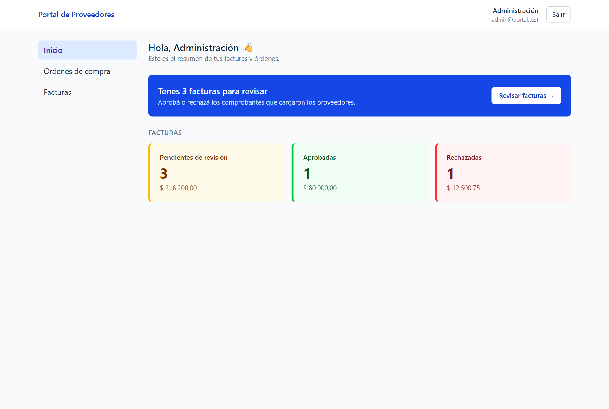
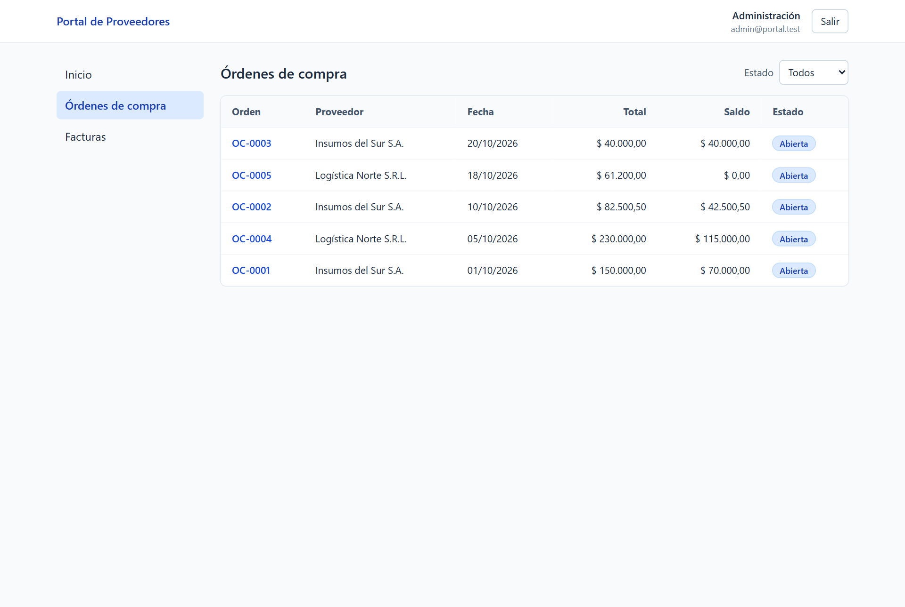
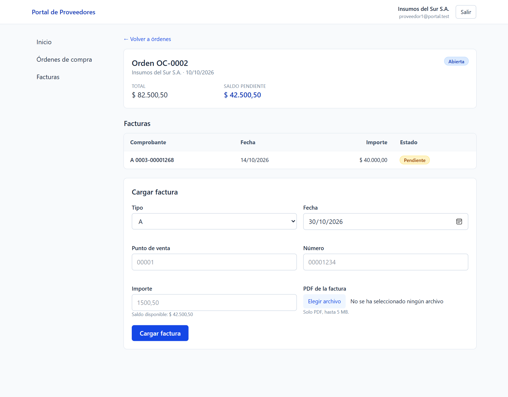
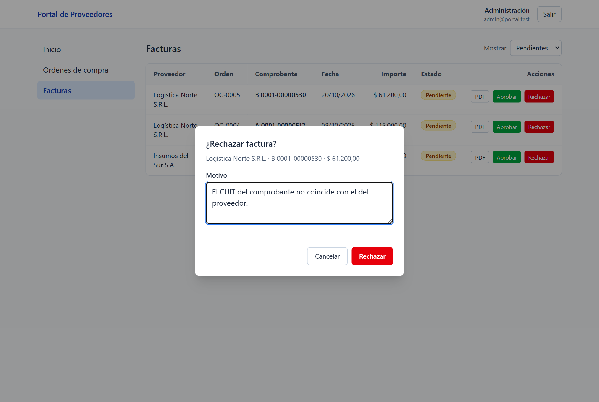
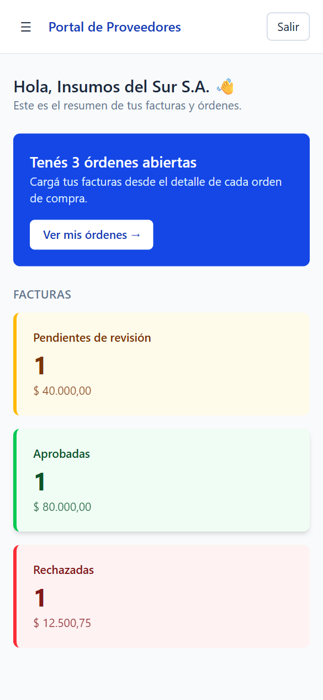

# Portal de Proveedores


Portal web donde los **proveedores** consultan sus órdenes de compra y cargan sus facturas con el PDF, y la **empresa** las revisa, aprueba o rechaza.

Es un proyecto personal para practicar un flujo típico de un ERP con **PHP 8.3 + Slim**, **PostgreSQL** y **Vue 3**, cuidando la seguridad, los tests y la experiencia de uso.



| Órdenes de compra | Carga de factura (proveedor) | Revisión (admin) |
|---|---|---|
|  |  |  |

<p align="center"></p>

## Funcionalidades

- **Login con roles:** `admin` (empresa) y `proveedor`.
- **Inicio con resumen:** cantidad e importe de facturas por estado, y una acción principal según el rol ("Tenés 3 facturas para revisar").
- Cada proveedor ve **solo sus** órdenes y facturas.
- **Carga de facturas** (tipo, punto de venta, número, fecha, importe y PDF) con reglas de negocio:
  - no se puede cargar dos veces la misma factura;
  - el importe no puede superar el saldo pendiente de la orden;
  - solo se aceptan PDF de hasta 5 MB;
  - el importe acepta coma decimal (`1500,50`), como se escribe en Argentina.
- **Revisión por parte del admin:** aprueba o rechaza con motivo obligatorio, con confirmación previa.
- **Descarga del comprobante**, con control de permisos.
- **Interfaz responsive:** tablas en escritorio, tarjetas en mobile, estados de carga, vacío y error, y notificaciones.

## Stack

| Capa | Tecnologías |
|---|---|
| Backend | PHP 8.3, Slim 4, PDO, firebase/php-jwt, PHPUnit |
| Base de datos | PostgreSQL 16 |
| Frontend | Vue 3 (Composition API + un componente en Options API), TypeScript, Pinia, Vue Router, Tailwind CSS, Vitest |
| Infraestructura | Docker Compose, GitHub Actions |

## Cómo correrlo

Requisitos: Docker Desktop y Node 22.18 o superior.

```bash
cp .env.example .env               # completá JWT_SECRET (openssl rand -hex 32) y POSTGRES_PASSWORD
docker compose up -d               # API en http://localhost:8080 (la base se crea con datos de prueba)

cd frontend
npm install
npm run dev                        # App en http://localhost:5173
```

**Usuarios de prueba** (contraseña `Demo1234!`):

| Email | Rol |
|---|---|
| `admin@portal.test` | Administración |
| `proveedor1@portal.test` | Proveedor: Insumos del Sur S.A. |
| `proveedor2@portal.test` | Proveedor: Logística Norte S.R.L. |

**Tests:**
```bash
docker compose exec -u www-data backend vendor/bin/phpunit --testdox   # backend (mismo usuario que Apache)
cd frontend && npm run test:unit -- --run                  # frontend
```

## Arquitectura

```
backend/src
├── Controllers/    HTTP: leen el request y devuelven JSON
├── Services/       reglas de negocio (saldo, duplicados, validaciones)
├── Repositories/   SQL con prepared statements
├── Middleware/     autenticación, roles, errores y headers de seguridad
└── Support/        JWT, validación de CUIT, configuración

frontend/src
├── api/            cliente HTTP (axios) con manejo de sesión vencida
├── stores/         estado global con Pinia (sesión, notificaciones)
├── views/          pantallas
├── components/     componentes reutilizables (badge, diálogo, formulario, toasts)
└── router/         rutas con guards por rol
```

## Decisiones técnicas

- **Slim con capas** (controller → service → repository) en lugar de un framework completo, para tener control de la arquitectura y del SQL.
- **JWT en una cookie `HttpOnly` + `SameSite=Strict`**, no en `localStorage`. El token no es accesible desde JavaScript (protege contra XSS) y no viaja en requests desde otros sitios (CSRF). Para saber si hay sesión, el front consulta `/api/me`.
- **Control de acceso a nivel de dato:** el `proveedor_id` siempre sale del token y se aplica en la consulta SQL. Un recurso ajeno devuelve **404**, para no confirmar que existe (prevención de IDOR).
- **Concurrencia:** la carga de una factura corre en una transacción con `SELECT ... FOR UPDATE` sobre la orden, así dos cargas simultáneas no pueden superar el saldo. La aprobación usa un `UPDATE ... WHERE estado = 'pendiente'` atómico, así que dos admins no pueden procesar la misma factura.
- **Integridad en la base:** `CHECK`, `UNIQUE` y claves foráneas como última línea de defensa, incluso ante un bug en el código.
- **Importes en `NUMERIC`** y comparaciones en centavos enteros, para evitar errores de punto flotante.
- **Validación de CUIT** con el algoritmo de dígito verificador (módulo 11) de AFIP, cubierta por tests unitarios.
- **Validación doble:** en el front para dar feedback inmediato y en el back como fuente de verdad. Los errores del back vuelven por campo y se muestran debajo de cada input.

## Seguridad (OWASP)

- **Inyección SQL:** todas las consultas con prepared statements reales (`ATTR_EMULATE_PREPARES = false`).
- **Control de acceso:** roles por ruta, filtro por proveedor en cada consulta y tests automáticos de IDOR.
- **Autenticación:**
  - contraseñas con bcrypt;
  - JWT firmado con expiración;
  - mensajes que no revelan si el usuario existe;
  - **rate limit** de login: 5 intentos fallidos cada 15 minutos por IP.
- **Subida de archivos:**
  - tamaño máximo;
  - **tipo real verificado con `finfo`** (no por la extensión);
  - nombre aleatorio;
  - guardado **fuera del document root**;
  - descarga solo a través de un endpoint que valida permisos.
- **Configuración:**
  - secretos en `.env`, que no se versiona;
  - errores sin detalles internos en producción;
  - headers `X-Content-Type-Options`, `X-Frame-Options`, `Content-Security-Policy` y `Referrer-Policy`.
- **Dependencias:** `composer audit` y `npm audit` en cada PR.

## Integración continua

En cada push y pull request, GitHub Actions corre en paralelo:
- **Backend:** levanta PostgreSQL, carga el schema, corre `composer audit` y los tests de PHPUnit.
- **Frontend:** lint (oxlint + ESLint), chequeo de tipos, tests de Vitest, build y `npm audit`.

## Uso de IA

<!-- Completá con tu caso real -->
Usé Claude Code como asistente para [por ejemplo: revisar código, diagnosticar errores de entorno y consultar la documentación de Slim y Vue]. La arquitectura, las reglas de negocio y los tests los definí yo, y revisé cada cambio antes de mergearlo.

## Próximas mejoras

- Refresh tokens y cierre de sesión en todos los dispositivos.
- Notificación por mail al proveedor cuando se resuelve una factura.
- Tests end-to-end con Playwright.
- Deploy público.
